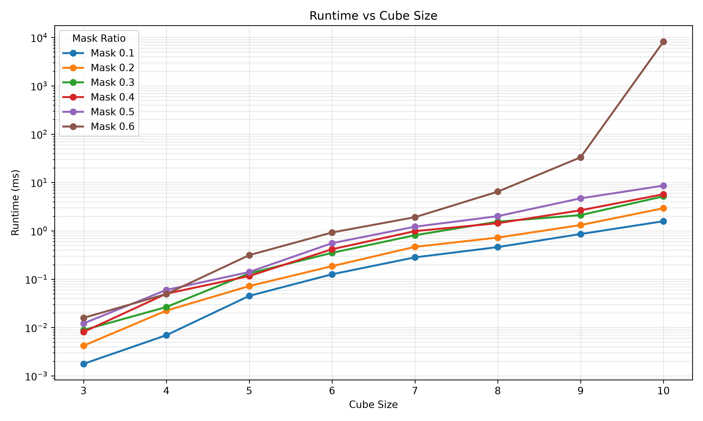
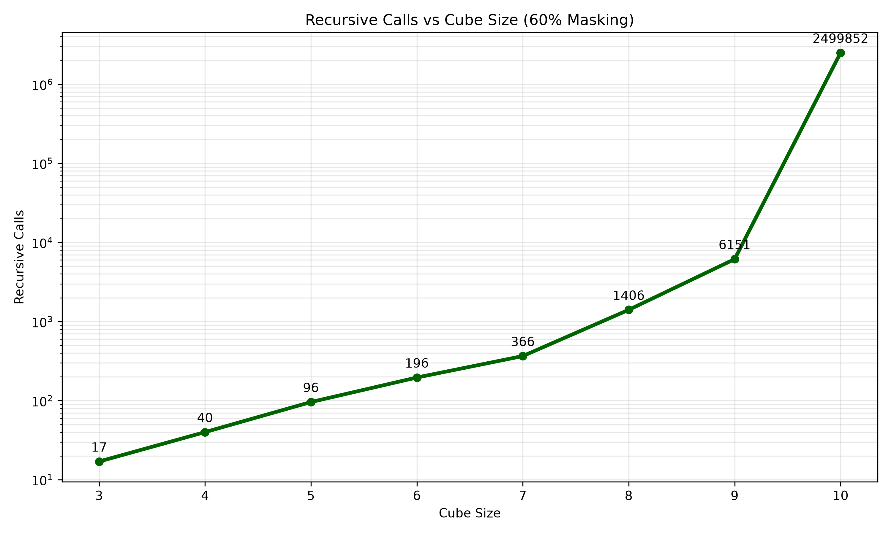

# Enchanted Latin Cube Solver

A C++ implementation of a Latin Cube puzzle generator and solver using recursive backtracking. This project was developed for **Assignment II – Task 3: Enchanted Latin Cube** from the *Algorithm Design Pattern Zoo* coursework.

---

## Overview

A Latin cube of size **n³** is a three-dimensional extension of a Latin square.

Each symbol from **1..n** must appear exactly once in:

- Every row
- Every column
- Every depth line

The objective is to reconstruct a partially masked Latin cube using a recursive backtracking algorithm.

The project includes:

- Latin cube generation
- Puzzle randomization
- Recursive backtracking solver
- Runtime benchmarking
- Recursive call analysis
- Automated graph generation

---

## Features

- Latin cube generation using:

```cpp
(layer + row + col) % n + 1
```

- Symbol renaming
- Random layer permutation
- Random cell masking
- Recursive backtracking solver
- Runtime benchmarking
- Recursive call counting
- CSV dataset generation
- Automated graph generation

---

## Project Structure

```text
task3_Enchanted_Latin_cube/
│
├── data/
│   ├── benchmark.csv
│   ├── generated_cube.csv
│   ├── masked_cube.csv
│   └── solved_cube.csv
│
├── report/
│   ├── graph.py
│   ├── runtime_vs_size_log.png
│   ├── recursive_calls_vs_size.png
│   ├── runtime_pair_9_10_log.png
│   └── hard_recursive_calls.png
│
├── src/
│   ├── Cube.h
│   ├── Cube.cpp
│   ├── Solver.h
│   ├── Solver.cpp
│   └── main.cpp
│
└── README.md
```

---

## Building

Compile the project using:

```bash
g++ src/*.cpp -o benchmark
```

--*

## Usage

Run the benchmark exec*table:

```bash
./benchmark.exe
``*

The program:

1. Generates sampl**Latin*cubes.
2. Creates masked puzzle in*tances.
3. Solves puzzles using re*ursive backtracking.
4. Runs perfo*mance benchmarks*
5. Saves benchmark results*to `data/benchmark.csv`.

Generate*graphs with:

```bash
py -3.13 rep*rt/graph.py
```

Generated graphs *re saved in:

```text
report/
```
*---

## Example Output

### Sample*Puzzle

```text
Layer 0
2 0 4 0
3 * 0 2
4 1 2 3
0 2 3 4

Layer 1
3 4 * 2
4 1 0 3
1 2 0 4
2 0 4 1
```

##* Solved Puzzle

```text
Layer 0
2 * 4 1
3 4 1 2
4 1 2 3
1 2 * 4

Layer 1
3 4 1 2*4 1 2 3
1 2 3 *
2 3 4 1
```

### Benchmark Output*
```text
Size: 8 Ratio: 0.6 Runtim** 6.47 ms Calls: 1406
Size: * Ratio: 0.6 Runtime: 33.23 ms Call** 6151
Size: 10 Ratio: 0.6*Runtime: 8217.13 ms Calls: 2499852*
Benchmark complete.
```

---

## *enchmark Configuration

| Paramete* | Values |
|------------|--------*|
| Cube*Sizes | 3, 4, 5, 6, *, 8, 9, 10 |
| Mask Ratios*| 10%, 20%, 30%, 40%, 50*, 60% |
| Repetitions | 20 runs |
*---

## Algorithm

### Latin Cube *eneration

A valid Latin cube is g*nerated using*

```cpp
cube[layer][row][col] =
 *  (layer + row + col) % n + 1;
```*
This guarantees that every symbol*appears exactly once in every row,*column, and depth line.

### Puzzl* Generation

The generated cube is*randomized through:

- Symbol rena*ing
- Layer permutation
- Random m*sking

### Backtracking Solver

Th* solver:

1. Finds the next empty *ell.
2. Tries candidate values fro* `1` to `n`.
3. Checks row, column* and depth constraints.
4. Recursi*ely continues solving.
5. Backtrac*s when a conflict is encountered.
*---

## Complexity Analysis

Let:
*- `n` = number of symbols
- `m` = *umber of masked cells

For each em*ty cell, the solver may attempt up*to `n` candidate values.

Worst-ca*e complexity:

```text
O(n^m)
```
*The exponential nature of this com*lexity suggests:

- Increasing run*ime for larger cubes.
- Increasing*runtime for higher masking ratios.*- Rapid growth of recursive calls *or difficult puzzle instances.

--*

## Results

### Representative R*sults (60% Masking)

| Cube Size |*Runtime (ms) | Recursive Calls |
|*----------|-------------:|--------*-------:|
| 3 | 0.016 | 17 |
| 4 |*0.049 | 40 |
| 5 | 0.315 | 96 |
| * | 0.926 | 196 |
| 7 | 1.917 | 366*|
| 8 | 6.467 | 1,406 |
| 9 | 33.2*4 | 6,151 |
| 10 | 8217.130 | 2,49*,852 |

### Hardest Observed Insta*ce

| Metric | Value |
|----------*-------:|
| Cube Size | 10 |
| Mas* Ratio | 60% |
| Runtime | 8217 ms*|
| Recursive Calls | 2,499,852 |
*---

## Findings

### Runtime Grow*h

Runtime increased with both cub* size and masking ratio.

Small cu*es were solved almost instantly, w*ile larger heavily masked cubes re*uired substantially more computati*n. The most difficult benchmark in*tance (**size 10**, **60% masking**) required more than **8 seconds***to solve.

### Recursive Search Gr*wth

The number of recursive calls*increased rapidly as problem diffi*ulty increased.

At **60% masking**, recursive calls increased from:
*```text
17
```

for a cube of size***3**

to

```text
2,499,852
```

*or a cube of size **10**.

This de*onstrates the rapid expansion of t*e search space typical of backtrac*ing algorithms.

### Comparison wi*h Theory

The observed behavior ma*ches the theoretical complexity:

*``text
O(n^m)
```

where:

- `n` i* the number of symbols.
- `m` is t*e number of masked cells.

As cube*size and masking ratio increase, t*e solver must explore a significan*ly larger search space, leading to*substantial increases in runtime a*d recursion depth.

---

## Genera*ed Graphs

### Runtime vs Cube Siz* (Log Scale)

*
**Observation**

- Runtime increa*es with cube size.
- Higher maskin* ratios consistently produce longe* runtimes.
- The logarithmic scale*reveals growth trends that are dif*icult to see on a linear scale.

-*-

### Recursive Calls vs Cube Siz*

*
**Observation**

- Recursive call* increase rapidly with cube size.
* Higher masking ratios require sub*tantially more search effort.
- Th* growth pattern supports the expec*ed exponential behavior of backtra*king.

---

### Runtime vs Mask Ra*io (Log Scale, Sizes 9 and 10)


**Observatio***

- Runtime increases as the mas*ing ratio increases.
- The effect *s especially pronounced for larger*cube sizes.
- The size 10 curve gr*ws much faster than the size 9 cur*e, demonstrating the sensitivity o* backtracking to problem difficult*.

---

### Recursive Calls vs Cub* Size (60% Masking)

*
**Observation**

- Recursive call* increase dramatically as cube siz* grows.
- The increase between siz*s 9 and 10 is particularly signifi*ant.
- The largest benchmark insta*ce required approximately **2.5 mi*lion recursive calls**.
- This gra*h provides the strongest empirical*evidence of search-space explosion*

---

### Graph Summary

The gene*ated graphs support the following *onclusions:

- Runtime increases w*ked cubes create significantly larger search spaces.
- The empirical results are consistent with the theoretical worst-case complexity:

```text
O(n^m)
```

where:

- `n` is the number of symbols.
- `m` is the number of masked cells.

---

## Conclusions

The experimental results confirm that recursive backtracking efficiently solves small and moderately sized Latin cubes.

However, runtime and recursive calls grow rapidly as cube size and masking ratio increase. The largest benchmark instance required approximately **2.5 million recursive calls** and more than **8 seconds** of computation time, demonstrating the exponential growth of the search space predicted by the theoretical analysis.

Overall, the benchmark results are consistent with the expected behavior of a backtracking solver.

---

## Author

**Desire Roslin Dziele**

University of Lodz  
Algorithms and Data Structures